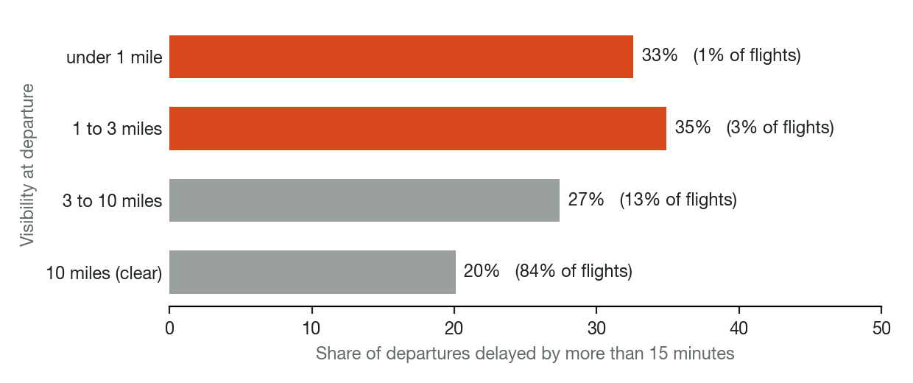

# Flight delays in SQL

Six SQL queries on all 336,776 flights that left New York City's three airports (JFK, LGA, EWR) in 2013, joined with airline, airport, aircraft and hourly weather data.

The goal was to practise the SQL I use at work (joins, conditional aggregation, CTEs, window functions) on a public dataset I can share, and to check the data before drawing conclusions.

**Data:** [nycflights13](https://github.com/tidyverse/nycflights13), originally from the US Bureau of Transportation Statistics. Five tables: `flights`, `airlines`, `airports`, `planes`, `weather`.

## Run it

```bash
python3 build_db.py      # loads the CSV files into flights.db (SQLite, standard library only)
python3 run_queries.py   # runs every file in queries/ and writes results/*.csv
python3 make_chart.py    # optional, needs matplotlib
```

## Queries and findings

| # | Question | SQL techniques | Finding |
|---|---|---|---|
| 01 | What can I trust in this data? | `UNION ALL` checklist, anti-join, `GROUP BY … HAVING` | 8,255 cancelled flights; 50,094 flights (15%) reference aircraft missing from `planes`, almost all from Envoy and American. Any analysis by aircraft type would be biased against those two airlines. |
| 02 | Which airline is most punctual? | `JOIN`, `CASE` inside `SUM`, `HAVING` | US Airways, Virgin America and Delta land about 82% of flights on time (≤ 15 min). ExpressJet and AirTran stay below 69%. |
| 03 | How does punctuality change month by month? | CTEs, `LAG() OVER (PARTITION BY … ORDER BY …)` | December hits all large airlines: JetBlue's on-time rate drops 23 points from November, United's 20 and ExpressJet's 19. |
| 04 | Which routes are worst from each airport? | `RANK() OVER (PARTITION BY origin …)` | Newark to Richmond averages 26 minutes of arrival delay over 1,667 flights. |
| 05 | Does visibility explain delays? | Join on two keys (airport + hour), `CASE` buckets, `SUM(COUNT(*)) OVER ()` | Below 3 miles visibility, 33–35% of departures are delayed, against 20% in clear weather. Poor visibility only affects 4% of flights. |
| 06 | Which days were unusually bad? | Window frame `ROWS BETWEEN 7 PRECEDING AND 1 PRECEDING` | 8 March 2013 stands out: 84 minutes average delay after a week of 11. |



## Things I decided on purpose

- **On time means arriving at most 15 minutes late**, the usual industry definition. Cancelled flights are counted separately and not mixed into the on-time rate.
- **Minimum sample sizes:** airlines with fewer than 1,000 flights and routes with fewer than 365 flights are left out, so a handful of flights cannot top a ranking.
- **Query 06 ranks by the jump in minutes, not by the ratio.** A ratio overrates days after a very calm week: 9.6 minutes after a week of 0.9 is "11 times normal" but not a bad day.
- **Correlation, not cause:** low visibility goes together with other bad weather, so query 05 shows an association, not the effect of visibility alone.

## Files

```
build_db.py        load CSV files into SQLite
run_queries.py     run all queries, save results as CSV
make_chart.py      chart for this README
queries/           the six SQL files
results/           query output (CSV) and chart
data/              source data (nycflights13)
```
